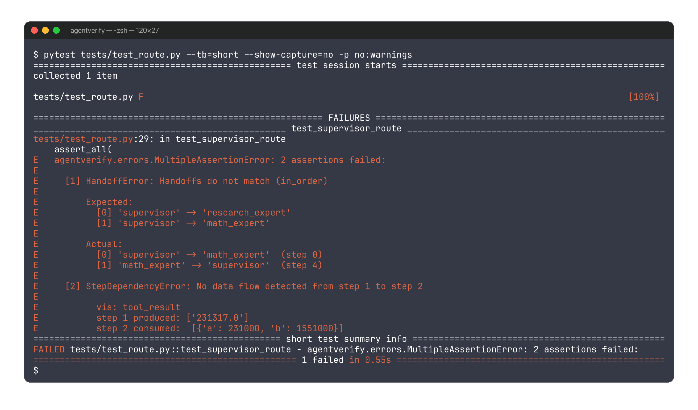
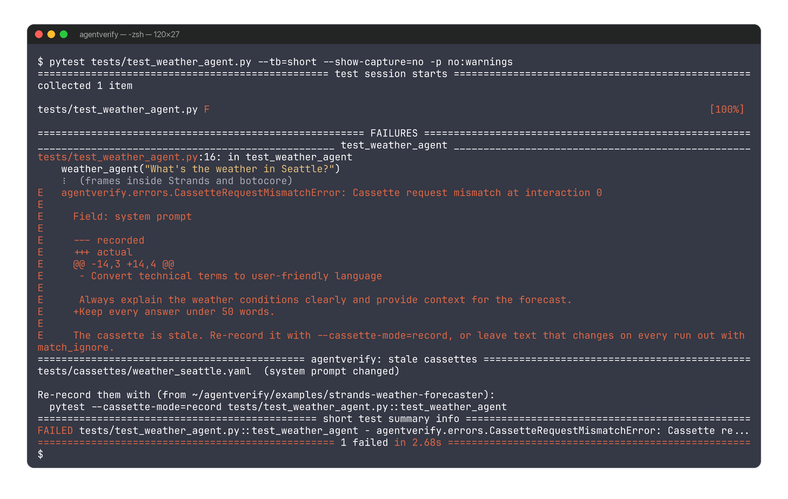
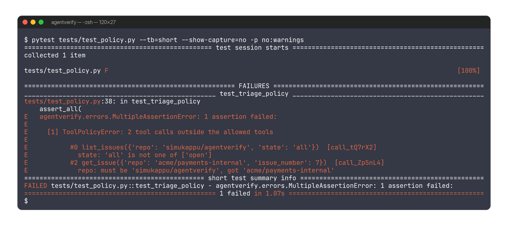

# agentverify

[](https://pypi.org/project/agentverify/)
[](https://pepy.tech/projects/agentverify)
[](https://github.com/simukappu/agentverify/actions/workflows/ci.yml)
[](https://coveralls.io/github/simukappu/agentverify?branch=main)
[](LICENSE)

**pytest for AI agents.** Assert agent actions, not vibes.

agentverify is a pytest plugin for deterministic testing of AI agent actions. Record real LLM calls and the agent's tool calls once, and replay them in CI with zero cost, or run against a live LLM with flexible matchers that tolerate prompt variation. Either way, assert exactly what your agent did: which tools it called, what data flowed between steps, how much it cost, and whether it stayed within your safety rules.



Specifically:

- **Tool call sequences**: exact order, subsequence, or set membership, with regex / wildcard argument matching, and an allow list with argument conditions
- **Step-level execution**: each LLM call is a step; assert what tool was called at step N, what the step's output was, and that step N's input references data produced by step M
- **Tool outcomes**: whether each tool call actually returned a usable result (vs. errored, timed out, or came back empty), what the result contained, and how many times a flaky tool was retried
- **Multi-agent routing**: which agent handed off to which, and which agent acted at each step
- **Budgets**: token counts, cost in USD, end-to-end latency
- **What the model was sent**: no credential URLs, and your own checks on every text in the requests
- **Cassettes that stay honest**: replay fails when the prompt or a tool schema changed, or when a cassette is past its age limit
- **Production traces**: the same assertions on OpenTelemetry traces

Adapters cover LangChain, LangGraph, Strands Agents, OpenAI Agents SDK, Pydantic AI, Google ADK, and CrewAI; a small [custom converter](#custom-converters) plugs in anything else. LLM providers: OpenAI (Chat Completions and Responses), Amazon Bedrock, Google Gemini, Anthropic, and LiteLLM, sync or async, streamed or not. Cassettes are human-readable YAML: commit them to git, review them in PRs, run them in CI without an API key.

## Why I built this

When I started building agents that call tools in a loop, I ran into a failure mode that is easy to introduce and easy to miss: the agent calls the wrong tool, ignores a tool result, or quietly retries a failing call until the budget runs over. I wanted those caught in CI the way any other regression is. But the usual options did not fit. Mocking everything proves nothing, and running against a real LLM is unreliable, costs money, and needs an API key in CI.

What I wanted was boring. Run the agent once, record what it did, and assert on it in CI like any other function: the tool sequence, the arguments, the cost, the steps where one tool's output feeds the next. Review the recording in the PR next to the prompt change that produced it. No judge model, no scoring, no cloud account. agentverify is deliberately narrow, and the cassette-replay path is what keeps those tests in CI without a key or a bill.

This is probably for you if:

- You've shipped an agent that calls tools in a loop and need CI-safe regression tests for it
- You've hit bugs like "it ignored the tool result" or "it called the wrong tool"
- You want prompt and tool changes reviewed in PRs via a concrete diff, not an informal "looks fine locally" signoff
- You're building on MCP servers and need to pin down which tools get called with which arguments
- You want token, cost, and latency budgets enforced in CI, not caught only on the billing dashboard

agentverify does one job in agent evaluation: deterministic regression tests on what the agent did. It runs next to a quality-evaluation tool, not instead of one:

- **On every PR: agentverify.** Assert tool calls, arguments, step-to-step data flow, handoffs, cost, and latency in pytest. Replay calls no LLM and no tool, needs no secret or cloud account, and runs in seconds. The same assertions also run on [production traces](#production-traces).
- **On staging, on a schedule: a judge-based evaluator** such as Amazon Bedrock AgentCore Evaluations, DeepEval, or LangSmith. Score answer quality and run datasets, where the judge model's cost is worth paying.

## Install

```bash
pip install agentverify
```

Requires Python 3.10+ and pytest 7+.

## Quick Start

After [installing](#install), copy this into `test_agent.py` and run `pytest`. No LLM calls, no API keys, no cassettes needed. Just pure assertions on an `ExecutionResult`.

```python
from agentverify import (
    ExecutionResult, ToolCall, ANY,
    assert_tool_calls, assert_cost, assert_no_tool_call, assert_final_output,
)

# Build an ExecutionResult from your agent's output (or a dict)
result = ExecutionResult.from_dict({
    "tool_calls": [
        {"name": "get_location", "arguments": {"city": "Tokyo"}},
        {"name": "get_weather", "arguments": {"lat": 35.6, "lon": 139.7}},
    ],
    "token_usage": {"input_tokens": 50, "output_tokens": 30},
    "total_cost_usd": 0.002,
    "final_output": "The weather in Tokyo is sunny, 22°C.",
})

def test_tool_sequence():
    assert_tool_calls(result, expected=[
        ToolCall("get_location", {"city": "Tokyo"}),
        ToolCall("get_weather", {"lat": ANY, "lon": ANY}),
    ])

def test_budget():
    assert_cost(result, max_tokens=500, max_cost_usd=0.01)

def test_safety():
    assert_no_tool_call(result, forbidden_tools=["delete_user", "drop_table"])

def test_output():
    assert_final_output(result, contains="Tokyo")
```

```
$ pytest test_agent.py -v
test_agent.py::test_tool_sequence PASSED
test_agent.py::test_budget PASSED
test_agent.py::test_safety PASSED
test_agent.py::test_output PASSED
```

> **Using a real agent framework?** See the [Real-World Example](#real-world-example) below, or the [Examples](#examples) table for every runnable sample.

## Real-World Example

### Strands Weather Forecaster — Two-Step ReAct

Test the [Strands Weather Forecaster](https://strandsagents.com/docs/examples/python/weather_forecaster/), an official Strands Agents sample. The agent uses the `http_request` tool to call the National Weather Service API, which returns the forecast URL for the requested location; the agent then calls that URL to get the actual forecast. Two steps, one piece of data flowing between them: the simplest shape of a ReAct loop.

```python
import pytest
from agentverify import (
    assert_tool_calls, assert_cost, assert_latency,
    assert_no_tool_call, assert_final_output, assert_all,
    ToolCall, MATCHES,
)

# Import the weather agent from the Strands sample
# (see https://strandsagents.com/docs/examples/python/weather_forecaster/)
from weather_agent import weather_agent


@pytest.fixture(autouse=True)
def fresh_conversation():
    """The sample's agent is a module-level object that keeps its conversation between calls."""
    weather_agent.messages.clear()


@pytest.mark.agentverify
def test_weather_agent(cassette):
    """Verify tool sequence, budget, latency, safety, and final output in one go."""
    with cassette("weather_seattle.yaml", provider="bedrock") as rec:
        weather_agent("What's the weather in Seattle?")

    result = rec.to_execution_result()
    assert_all(
        result,
        # Two http_request calls with distinct URL shapes: location lookup then forecast
        lambda r: assert_tool_calls(r, expected=[
            ToolCall("http_request", {"method": "GET", "url": MATCHES(r"/points/")}),
            ToolCall("http_request", {"method": "GET", "url": MATCHES(r"/forecast")}),
        ]),
        lambda r: assert_cost(r, max_tokens=15000),
        lambda r: assert_latency(r, max_ms=10_000),
        lambda r: assert_no_tool_call(r, forbidden_tools=["write_file", "execute_command"]),
        lambda r: assert_final_output(r, contains="Seattle"),
    )
```

Want to go deeper? Step-level assertions verify the ReAct structure and the data flow between the two steps:

```python
from agentverify import assert_step, assert_step_uses_result_from

@pytest.mark.agentverify
def test_weather_agent_steps(cassette):
    with cassette("weather_seattle.yaml", provider="bedrock") as rec:
        weather_agent("What's the weather in Seattle?")
    result = rec.to_execution_result()

    # First step must call /points/ to discover the forecast office
    assert_step(result, step=0, expected_tool=ToolCall(
        "http_request", {"method": "GET", "url": MATCHES(r"/points/")},
    ), partial_args=True)

    # Second step must call /forecast/ AND use data from the first step's result
    assert_step(result, step=1, expected_tool=ToolCall(
        "http_request", {"method": "GET", "url": MATCHES(r"/forecast")},
    ), partial_args=True)
    assert_step_uses_result_from(result, step=1, depends_on=0)
```

`MATCHES(pattern)` is a regex matcher. See [Assertion Modes](#assertion-modes) for `ANY`, `MATCHES`, `OrderMode`, and `partial_args`, and [Step-Level Assertions](#step-level-assertions) for the step API. More agents, from an LLM-as-a-judge loop to an ADK agent team, are in the [Examples](#examples).

## Build an ExecutionResult

Every agentverify assertion takes an `ExecutionResult`. You can build one three ways:

1. **From a dict**: convenient for quick tests and fixtures, as in the [Quick Start](#quick-start).
2. **From a built-in adapter**: one-liner for LangChain, LangGraph, Strands Agents, OpenAI Agents SDK, Pydantic AI, Google ADK, and CrewAI. See [Framework Integration](#framework-integration).
3. **From a custom converter**: for frameworks or pure-Python agents not covered by a built-in adapter, map your output to the schema below. See [`examples/custom-converter-python-agent/`](examples/custom-converter-python-agent/) for a complete walkthrough with an Anthropic SDK agent, including a pre-recorded cassette and step-level tests.

`ExecutionResult.from_dict()` accepts these keys:

| Key | Type | Description |
|---|---|---|
| `steps` | `list[dict]` | Each step dict has `index` (int), `source` (`"llm"` / `"probe"` / `"tool"`), `tool_calls` (list), `tool_results` (list), `tool_results_meta` (list or None, see [Tool Result Assertions](#tool-result-assertions)), `output` (str or None), `input_context` (dict or None), `name` (str or None), `agent` (str or None), `token_usage` (dict or None), `duration_ms` (float or None). See [Step-Level Assertions](#step-level-assertions) |
| `tool_calls` | `list[dict]` | **Shortcut for single-step cases**: when `steps` is absent, a flat `tool_calls` list is wrapped into a single synthetic step. Used throughout the [Quick Start](#quick-start). Each dict has `name` (str, required), `arguments` (dict, optional), `result` (any, optional), `call_id` (str, optional) |
| `token_usage` | `dict` or `None` | `{"input_tokens": int, "output_tokens": int}` |
| `total_cost_usd` | `float` or `None` | Total cost in USD (must be set manually, not auto-calculated from tokens or populated from cassettes) |
| `duration_ms` | `float` or `None` | Wall-clock duration in milliseconds (auto-populated by the `cassette` fixture and `MockLLM`) |
| `final_output` | `str` or `None` | The agent's final text response |
| `handoffs` | `list[dict]` or `None` | `{"from_agent", "to_agent", "step"}` entries; without it, handoffs are derived from the steps' `agent`. See [Multi-Agent Handoffs](#multi-agent-handoffs) |

`ExecutionResult.from_json(json_string)` and `to_dict()` / `to_json()` are also available for serialization.

## Record & Replay with Cassettes

Record real LLM API calls once, then replay them in CI forever. Zero cost, fully deterministic.

```python
import pytest
from agentverify import assert_tool_calls, ToolCall, ANY

@pytest.mark.agentverify
def test_weather_agent(cassette):
    with cassette("weather_agent.yaml", provider="openai") as rec:
        # Replace this with your actual agent invocation, e.g.:
        # agent.run("What's the weather in Tokyo?")
        run_my_agent("What's the weather in Tokyo?")

    # rec.to_execution_result() is called AFTER the with block exits
    result = rec.to_execution_result()
    assert_tool_calls(result, expected=[
        ToolCall("get_location", {"city": "Tokyo"}),
        ToolCall("get_weather", {"lat": ANY, "lon": ANY}),
    ])
```

The `cassette` fixture is provided by the agentverify pytest plugin. It creates an `LLMCassetteRecorder` that intercepts LLM SDK calls (not HTTP; it patches each SDK's call method directly). Use `@pytest.mark.agentverify` to mark your test, and call your agent code inside the `with cassette(...)` block. After the block exits, call `rec.to_execution_result()` to build the result for assertions.

```bash
# First run: record real LLM calls to cassette file
pytest --cassette-mode=record

# All subsequent runs: replay from cassette (zero cost, deterministic)
pytest
```

Cassettes are YAML (or JSON). There are four modes:

| Mode | Behavior |
|---|---|
| `AUTO` (default) | If cassette file exists → REPLAY. Otherwise → call real LLM API but don't save (no cassette file is created). |
| `RECORD` | Always call real LLM API and save to cassette file. |
| `REPLAY` | Always replay from cassette file. Raises error if file is missing. |
| `RECORD_MISSING` (`--cassette-mode=record-missing`) | If cassette file exists → REPLAY. Otherwise → RECORD. Adds new cassettes without re-recording (and paying for) the others; pytest lists the new ones at the end of the run. |

### Tool Calls

The cassette records the agent's tool calls too. Replay returns each tool's recorded result instead of running the tool, so a replayed test makes no tool requests, needs no tool credentials, and leaves no side effects:

```yaml
tool_executions:
- name: http_request
  arguments: {method: GET, url: https://api.weather.gov/points/47.6062,-122.3321}
  step: 0
  result: {status: success, content: [{text: ...}]}
```

Tools are recorded through every built-in framework and MCP's `ClientSession.call_tool`; for a hand-written agent, decorate the tool function with `@cassette_tool`. Calls match on the tool name and arguments; a call with no recording raises `CassetteToolMismatchError`. Replay does not restore what a tool changed in the process (Google ADK `tool_context.state`, Pydantic AI `deps`), so pass `replay_tools=False` when a test depends on that or on a tool's side effects. Which calls still run for real, and the other details, are in [docs/cassettes.md](docs/cassettes.md#tool-replay).

### Stale Cassette Detection

Replay checks that the agent still sends what was recorded: the model, the tool names and schemas, the system prompt, and the user's text ([details](docs/cassettes.md#request-matching)). A change raises `CassetteRequestMismatchError` with a diff, even if the agent's framework caught it, and pytest lists the stale cassettes and the command that re-records them:



Text that changes on every run, such as today's date in a prompt, can be left out with `match_ignore`, a list of regular expressions. `match_requests=False` (or `--no-cassette-match-requests`) turns matching off.

```python
with cassette("my_test.yaml", provider="openai", match_ignore=[r"\d{4}-\d{2}-\d{2}"]) as rec:
    run_my_agent("What's the weather?")
```

Matching leaves tool results alone, since a tool that runs for real may return something new. To also notice changed tool results, message roles, or parameters, turn on [drift](docs/cassettes.md#drift): `agentverify_cassette_drift = "warn"` in the pytest settings, or `cassette(drift="fail")` for the cassettes that matter most. It raises `CassetteDriftError` or lists the places that differ, never the values.

### Keeping Cassettes Current

- Re-record a cassette in the same PR as the prompt or tool change that made it stale
- Pin model versions (a dated snapshot, not a moving alias) so cassettes don't silently shift underneath you
- Treat cassette diffs as part of the PR review. A YAML diff next to the prompt diff is a feature, not noise
- Use `MATCHES` and `partial_args=True` to assert on the stable parts of tool arguments
- Set an expiry, so that cassettes nobody re-records fail instead of drifting away from the live model unnoticed:

```toml
# pyproject.toml
[tool.pytest.ini_options]
agentverify_cassette_max_age = "30d"   # replaying an older cassette raises CassetteExpiredError
```

```bash
pytest --cassette-max-age=7d         # this run only; cassette(max_age=...) sets one cassette
pytest --cassette-expired=warn       # warn instead of failing, when there is no time to re-record
pytest --cassette-report             # list the cassettes: recorded when, with which model, expired or not
pytest --cassette-mode=record-missing  # record only the cassettes that do not exist yet
```

The rules for ages, the report, and the calls cassettes cannot record are in [docs/cassettes.md](docs/cassettes.md).

### Async Agents

The cassette is a plain context manager, so it works around `await` calls too, in a sync test that runs the agent with `asyncio.run()` or inside your own async test. Async clients of every provider are recorded, and calls that overlap (`asyncio.gather`, threads) replay with their own responses:

```python
def test_async_agent(cassette):
    async def main():
        with cassette("judge.yaml", provider="openai") as rec:
            await run_agent("A detective story in space.")
        return rec.to_execution_result()

    result = asyncio.run(main())
    assert_final_output(result, contains="detective")
```

### Cassette Sanitization

Cassettes are sanitized by default when recording. Before saving, agentverify redacts:
- values that match a built-in key pattern, anywhere in the cassette
- call arguments and headers under a credential key, whatever their format: `api_key`, `authorization`, `x-api-key`, `cookie`, and names ending in `token`, `secret`, `password`, and similar (for example in `extra_headers`)

Built-in patterns (`DEFAULT_PATTERNS`) cover OpenAI and Anthropic API keys (`sk-...`, `sk-ant-...`), AWS access keys (`AKIA...`, `ASIA...`), Amazon Bedrock API keys (`ABSK...`, `bedrock-api-key-...`), Google API keys (`AIza...`), GitHub tokens (`ghp_...`, `github_pat_...`), and Bearer tokens.

A custom list replaces the built-in patterns, so extend `DEFAULT_PATTERNS` to keep them. Credential keys in call arguments are redacted either way:

```python
from agentverify import DEFAULT_PATTERNS, SanitizePattern

custom_patterns = [
    *DEFAULT_PATTERNS,
    SanitizePattern(name="internal_token", pattern=r"tok-[a-f0-9]{32}", replacement="tok-***REDACTED***"),
]

with cassette("test.yaml", provider="openai", sanitize=custom_patterns) as rec:
    run_my_agent("Do something")
```

Pass `sanitize=False` to disable sanitization entirely (not recommended).

## Assertion Modes

```python
from agentverify import assert_tool_calls, OrderMode, ToolCall, ANY, MATCHES

# Exact match: same tools, same order, same count (default)
assert_tool_calls(result, expected=[...])

# Subsequence: these tools appeared in this order (other calls in between are OK)
assert_tool_calls(result, expected=[...], order=OrderMode.IN_ORDER)

# Set membership: these tools were called (order doesn't matter)
assert_tool_calls(result, expected=[...], order=OrderMode.ANY_ORDER)

# Partial args: only check the keys you care about
assert_tool_calls(result, expected=[
    ToolCall("search", {"query": "Tokyo"}),
], partial_args=True)

# ANY wildcard: ignore a specific argument value
assert_tool_calls(result, expected=[
    ToolCall("get_weather", {"lat": ANY, "lon": ANY}),
])

# MATCHES regex: verify a string argument follows a pattern
# (re.search semantics; use ^/$ anchors for full match)
assert_tool_calls(result, expected=[
    ToolCall("send_email", {"to": MATCHES(r"^[\w.+-]+@example\.com$")}),
    ToolCall("log_event", {"event_id": MATCHES(r"^evt_[a-f0-9]{16}$")}),
])
```

Collect all failures at once instead of stopping at the first:

```python
from agentverify import assert_all
assert_all(
    result,
    lambda r: assert_tool_calls(r, expected=[...]),
    lambda r: assert_cost(r, max_tokens=1000),
    lambda r: assert_latency(r, max_ms=3000),
    lambda r: assert_no_tool_call(r, forbidden_tools=["delete_user"]),
    lambda r: assert_final_output(r, contains="Tokyo"),
)
```

### Allowed Tools

`assert_no_tool_call` names the tools that must not be called. `assert_tool_calls_allowed` names the ones that may, with conditions on their arguments, and fails on every other call:

```python
from agentverify import assert_tool_calls_allowed

assert_tool_calls_allowed(result, allowed={
    "get_weather": {
        "type": "object",
        "properties": {"city": {"type": "string", "maxLength": 40}, "days": {"type": "integer", "minimum": 1, "maximum": 7}},
        "required": ["city"],
        "additionalProperties": False,
    },
    "say_hello": None,  # any arguments
})
```



The conditions are a small part of JSON Schema, as tool parameter schemas use it: `type`, `enum`, `const`, `minimum`, `maximum`, `minLength`, `maxLength`, `pattern`, `required`, `properties`, and `additionalProperties`. Any other keyword raises `ValueError` rather than being ignored. Values are compared strictly: booleans are never numbers, `number` takes no NaN or infinity, `enum` and `const` compare types (`True` is not `1`), and, unlike JSON Schema, `integer` takes no float such as `3.0`. A failure (`ToolPolicyError`) lists each call outside the policy with its position, `call_id`, and reasons.

### Budgets and Final Output

`token_usage` and `duration_ms` are filled in by the `cassette` fixture, `MockLLM`, and every adapter; `total_cost_usd` is yours to set, since a pricing table would go stale. Replay measures replay time, so check latency on a recording or a live run.

```python
from agentverify import assert_cost, assert_final_output, assert_latency

assert_cost(result, max_tokens=500, max_cost_usd=0.01)   # either bound is optional
assert_latency(result, max_ms=3000)

assert_final_output(result, contains="Tokyo")             # or equals=..., matches=r"\d+°C"
assert_final_output(result, contains=["Tokyo", "22°C"], case_sensitive=False)
```

`assert_cost` and `assert_latency` pass when their data is missing; `strict=True` requires it. `assert_step_output` and `assert_tool_result_matches` take the same `contains` / `equals` / `matches` options as `assert_final_output`.

## Step-Level Assertions

For agents that make multiple LLM calls per execution (ReAct, Plan-and-Execute, multi-hop retrieval, workflow-style), agentverify exposes the full step structure, not just a flat list of tool calls.

`ExecutionResult.steps` is the single source of truth; `result.tool_calls` remains as a derived flat view for simpler cases.

```python
from agentverify import assert_step, assert_step_output, ToolCall, MATCHES

@pytest.mark.agentverify
def test_plan_and_execute(cassette):
    with cassette("trip_planner.yaml", provider="openai") as rec:
        plan_trip("2 nights in Shibuya, Tokyo")
    result = rec.to_execution_result()

    # Step 0: agent plans what to search for
    assert_step_output(result, step=0, contains="flights")

    # Step 1: agent calls the flight search tool
    assert_step(result, step=1, expected_tool=ToolCall("search_flights", {"city": "Tokyo"}))

    # Step 2: agent calls the hotel search with the neighborhood the user asked for
    assert_step(result, step=2, expected_tool=ToolCall("search_hotels", {"area": MATCHES(r"Shibuya")}))
```

### Assert Step-to-Step Data Flow

`assert_step_uses_result_from()` verifies that one step's input references data produced by another. Catches "agent ignored the tool result" bugs.

```python
from agentverify import assert_step_uses_result_from

# Verify step 2 (hotel search) actually uses the result of step 1 (flight search)
assert_step_uses_result_from(result, step=2, depends_on=1)

# Restrict to a specific channel
assert_step_uses_result_from(result, step=2, depends_on=1, via="tool_result")
```

The check searches for any produced value (step M's `tool_results`, `tool_calls[*].result`, or `output`) inside step N's `input_context` or `tool_calls[*].arguments`. Strings are substring-matched; primitives (numbers, booleans) are matched structurally inside containers; JSON-encoded tool results are descended automatically.

To see this concretely with a different example: if step 0's `list_issues` tool returned `[{"number": 1}, {"number": 2}]` and step 1 called `get_issue(issue_number=2)`, the check finds that the number `2` produced by step 0 shows up in step 1's arguments. Data flows correctly. This is exactly the pattern the [LangChain GitHub issue triage example](examples/langchain-issue-triage/) verifies.

This works on cassette replay: each step's tool results are read from the request that continues its conversation, where the agent sent them back to the model, for every provider.

### Workflow-Style Agents with `step_probe`

Many production agents aren't pure ReAct loops. They mix LLM calls with caching, state management, validation, and conditional branches. `step_probe()` lets you mark logical step boundaries in your agent code so tests can assert on those non-LLM steps.

```python
# agent.py
from agentverify import step_probe

def run_agent(query: str) -> str:
    with step_probe("fetch_cache") as p:
        cached = cache.get(query)
        p.set_tool_result({"hit": cached is not None})
        if cached:
            return cached
    with step_probe("call_llm"):
        response = llm.invoke(query)
    with step_probe("postprocess", output="formatted"):
        return format_output(response)
```

```python
# test_agent.py
def test_cache_miss_path():
    with MockLLM([mock_response(content="42")], provider="openai") as rec:
        run_agent("what's the answer?")
    result = rec.to_execution_result()
    assert_step(result, name="fetch_cache", expected_tools=[])  # probe with no tool calls
    assert_step_output(result, name="call_llm", contains="42")  # the LLM step returned the answer
    assert_step_output(result, name="postprocess", equals="formatted")
```

**`step_probe` is a zero-cost no-op outside of test recording contexts.** When no `LLMCassetteRecorder` or `MockLLM` is active, it's a pass-through context manager. Safe to leave in production code.

## Multi-Agent Handoffs

In a multi-agent run, assert which agent handed control to which, and which agent acted at a step.

```python
from agentverify import ANY, Handoff, ToolCall, assert_handoffs, assert_no_handoff, assert_step

assert_handoffs(result, expected=[
    Handoff("supervisor", "research_expert"),
    Handoff("research_expert", "supervisor"),
    Handoff("supervisor", "math_expert"),
])  # order=OrderMode.EXACT (default), IN_ORDER, or ANY_ORDER

assert_no_handoff(result, to_agent="admin_expert")

assert_step(result, step=1, agent="research_expert", expected_tool=ToolCall("web_search", ANY))
```

`result.handoffs` lists them, and `Step.agent` names the agent at each step.

- The framework adapters (`from_openai_agents`, `from_langgraph`, `from_google_adk`, `from_crewai`) and `from_otel` take agent names from the framework, and a handoff is a change of acting agent. Tool names are not read, so an ordinary tool named `transfer_to_savings` is not a handoff and a handoff tool renamed with `tool_name_override` still is.
- A cassette has no agent names. It reads handoffs from the `transfer_to_<agent>` / `transfer_back_to_<agent>` tool calls that the OpenAI Agents SDK and langgraph-supervisor make, and from Google ADK's `transfer_to_agent(agent_name=...)`. It names each step after the last handoff in its request history, or after the previous step's handoff when a new user turn follows that one. The first agent is unnamed (`Handoff(ANY, "research_expert")`), and returns to a supervisor are seen only when the framework writes them into the history, as langgraph-supervisor does by default.

Plain-string names compare as handoff tools spell them: `"Billing Agent"` matches `billing_agent`.

## Tool Result Assertions

Knowing the agent *called* the right tool is not the same as knowing the call *worked*. A tool can return a 5xx, time out, or hand back an empty body, and the LLM will often smooth that over in its final reply. These assertions check the result a tool handed back:

```python
from agentverify import (
    assert_tool_invocation_succeeded,
    assert_no_tool_errors,
    assert_tool_result_matches,
    assert_retry_count,
)

# Affirmative: the tool call(s) at this step returned a usable result
assert_tool_invocation_succeeded(result, step=1)

# Blanket safety net: no tool anywhere in the run errored
assert_no_tool_errors(result)

# The tool returned a well-shaped / non-empty result
assert_tool_result_matches(result, step=1, contains="temperature")
assert_tool_result_matches(result, step=1, matches=r'"temp":\s*\d+')
# Every substring must appear in the same tool result; case_sensitive=False ignores case
assert_tool_result_matches(result, step=1, contains=["temp", "unit"], case_sensitive=False)

# Budget on retries of a flaky tool (counted from consecutive repeat calls)
assert_retry_count(result, tool_name="http_request", max=2)
```

The adapters and cassette replay read each framework's own tool-error convention, and a result is a known error, a known success, or unknown; the assertions fail only on a known error, so a test gives the same verdict live and on replay ([details](docs/tool-results.md)). `assert_no_tool_errors` is a blanket gate: if the agent is meant to recover from a failure (a 429 then a retry), assert the steps that must succeed with `assert_tool_invocation_succeeded(step=N)` instead.

## Checking What the Model Was Sent

`iter_request_texts` walks every text the agent sent the model, with where it sits: the system prompt, each message with its role, tool call arguments and tool results with the tool's name, the tool definitions (including `enum` values), and the provider's other parameters, in every provider's shape. Use it for checks of your own (personal data, internal ids):

```python
from agentverify import assert_no_credential_urls, iter_request_texts

for where, text in iter_request_texts("tests/cassettes/weather_agent.yaml"):
    # where: request[1].message[3](tool).tool_result[0](get_weather).temp, ...
    assert not EMPLOYEE_ID.search(text), where

# Fails on a presigned link a tool returned, ?access_token=, X-Amz-Signature, a JWT, ...
assert_no_credential_urls("tests/cassettes/camera_history.yaml")
```

`assert_no_credential_urls` names where each URL was and its host, never the value. It also takes a recorder after the run; `extra_patterns` and `ignore` adjust what counts ([details](docs/cassettes.md#checking-what-the-model-was-sent)).

## Production Traces

`from_otel` turns OpenTelemetry traces of agent runs into `ExecutionResult`s, one per trace, so the same assertions run on what the agent did in production or on staging, without a judge model:

```python
from agentverify import assert_no_tool_call, assert_no_tool_errors
from agentverify.traces import from_otel

for result in from_otel("traces.jsonl"):  # an OTLP JSON export
    assert_no_tool_call(result, forbidden_tools=["delete_user"])
    assert_no_tool_errors(result)
```

It reads an OTLP JSON file or document, or the spans of the OpenTelemetry SDK (`InMemorySpanExporter.get_finished_spans()`). Each model call becomes a step with its tool calls, tool results and errors, token usage, and agent, and agent changes become handoffs (an agent called as a tool, or agents running in parallel, are not handoffs). Tested with the traces of Strands Agents, Pydantic AI, and Google ADK, and of the OpenAI Agents SDK through OpenInference and OpenLLMetry.

- Arguments, results, and text are in a trace only when the instrumentation captures message content. Without it, steps still carry tool names, errors, agents, and token usage.
- Tool results keep the shape the trace stores them in, which can differ from what the framework adapter returns for the same run (Strands stores the result's content blocks, ADK a `{"result": ...}` dict).

## Framework Integration

### Built-in Adapters

agentverify ships with built-in adapters for popular agent frameworks. No converter function needed. Just import and call:

| Framework | Adapter | Input |
|---|---|---|
| [LangChain](https://github.com/langchain-ai/langchain) | `from agentverify.frameworks.langchain import from_langchain` | Legacy `AgentExecutor.invoke()` dict |
| [LangGraph](https://github.com/langchain-ai/langgraph) | `from agentverify.frameworks.langgraph import from_langgraph` | `create_react_agent` / `create_supervisor` result dict, and LangChain 1.x `create_agent` result |
| [Strands Agents](https://github.com/strands-agents/sdk-python) | `from agentverify.frameworks.strands import from_strands` | The `Agent` after the call (its `messages` hold the conversation; the `AgentResult` does not). Token usage is the last call's |
| [OpenAI Agents SDK](https://github.com/openai/openai-agents-python) | `from agentverify.frameworks.openai_agents import from_openai_agents` | `RunResult` |
| [Pydantic AI](https://github.com/pydantic/pydantic-ai) | `from agentverify.frameworks.pydantic_ai import from_pydantic_ai` | `AgentRunResult` (pass `agent_name=` to name the steps' agent) |
| [Google ADK](https://github.com/google/adk-python) | `from agentverify.frameworks.google_adk import from_google_adk` | The events of `Runner.run()` / `run_async()`, streamed or not |
| [CrewAI](https://github.com/crewAIInc/crewAI) | `from agentverify.frameworks.crewai import from_crewai` | `CrewOutput` from `crew.kickoff()` (token usage is the crew total) |

LangChain 1.x `create_agent` returns a LangGraph graph, so pass its result to `from_langgraph`.

```python
from agentverify.frameworks.langchain import from_langchain
from agentverify.frameworks.langgraph import from_langgraph
from agentverify.frameworks.openai_agents import from_openai_agents
from agentverify.frameworks.strands import from_strands

execution_result = from_langgraph(app.invoke({"messages": [...]}))
execution_result = from_openai_agents(Runner.run_sync(agent, "your prompt"))

# Strands: the agent after the call (its messages include earlier calls; clear them between tests)
weather_agent("What's the weather in Seattle?")
execution_result = from_strands(weather_agent)

# Legacy AgentExecutor: pass the history to capture token usage
execution_result = from_langchain(result, messages=memory.chat_memory.messages)
```

### Custom Converters

For other frameworks, build an `ExecutionResult` from your agent's output using a small converter function. See [`examples/custom-converter-python-agent/`](examples/custom-converter-python-agent/) for a complete reference: an Anthropic SDK ReAct agent paired with a ~80-line `converter.py`, a recorded cassette, and step-level tests.

## Supported LLM Providers

Install the extra for the SDK your agent uses:

| Provider | Extra |
|---|---|
| OpenAI | `pip install "agentverify[openai]"` |
| Amazon Bedrock | `pip install "agentverify[bedrock]"` |
| Google Gemini | `pip install "agentverify[gemini]"` |
| Anthropic | `pip install "agentverify[anthropic]"` |
| LiteLLM | `pip install "agentverify[litellm]"` |
| All providers | `pip install "agentverify[all]"` |

OpenAI models on Bedrock can be reached through boto3 or the OpenAI SDK; see [docs/cassettes.md](docs/cassettes.md#recorded-and-unsupported-calls) for which provider records each route.

## LLM Mocking with MockLLM

`MockLLM` replays a list of predefined LLM responses that you define in code. Test your agent's routing logic without a cassette or a real LLM call. Useful when you haven't recorded yet, or when you want to drive the agent through hypothetical responses (errors, edge cases) that would be awkward to elicit from a real model.

```python
import pytest
from agentverify import (
    MockLLM, mock_response, ToolCall,
    assert_tool_calls, assert_no_tool_call,
)

def test_agent_routes_to_weather_tool():
    with MockLLM([
        mock_response(tool_calls=[("get_weather", {"city": "Tokyo"})]),
        mock_response(content="Tokyo is sunny, 22°C."),
    ], provider="openai") as rec:
        my_agent("What's the weather in Tokyo?")

    result = rec.to_execution_result()
    assert_tool_calls(result, expected=[ToolCall("get_weather", {"city": "Tokyo"})])
    assert_no_tool_call(result, forbidden_tools=["delete_user"])
```

`mock_response()` accepts:

- `content`: the final text message the LLM should return.
- `tool_calls`: a list of `(name, arguments)` tuples or `{"name": ..., "arguments": ...}` dicts; add `"id"` for a fixed tool call id (otherwise each call gets a unique one).
- `input_tokens` / `output_tokens`: optional token usage to report.

Provide one `mock_response(...)` per LLM call your agent is expected to make. If your agent makes more calls than you've queued, `MockLLM` raises [`CassetteMissingRequestError`](#error-messages) so under-specified tests fail loudly.

Use `MockLLM` for routing logic and hypothetical responses written in the test; use cassettes for fidelity with real LLM output and to catch prompt regressions.

## Live Runs and Pass Rates

A live model does not take the same path every time: a supervisor may route to the wrong agent one run in ten. To measure that with the same assertions, mark the test with how many runs it takes and the share that must pass:

```python
@pytest.mark.agentverify(runs=10, min_pass_rate=0.9)
def test_routes_billing_questions(cassette):
    with cassette("billing.yaml", provider="openai") as rec:
        run_supervisor("Why was I charged twice?")
    assert_handoffs(rec.to_execution_result(), expected=[Handoff(ANY, "billing")], order=OrderMode.IN_ORDER)
```

```bash
pytest                      # replays the cassette once, as usual
pytest --agentverify-live   # runs it 10 times against the live model; fails below 90%
```

Under `--agentverify-live`, every `cassette` in a test marked with `runs=` calls the real model and tools and saves nothing, whatever `mode` or `cassette_dir` it was given. Each run is a full run of the test, with its function-scoped fixtures set up again, so async tests (pytest-asyncio, anyio) and parametrized tests work as usual. A run that skips is not counted. The end of the session lists each test's pass rate and failed runs (under pytest-xdist too). It costs one agent run per `runs`, so it fits a nightly job or a check before release, not every PR. `min_pass_rate` defaults to 1.0.

## CI Integration

### GitHub Actions

```yaml
name: Agent Tests
on: [push, pull_request]

jobs:
  test:
    runs-on: ubuntu-latest
    steps:
      - uses: actions/checkout@v7
      - uses: actions/setup-python@v7
        with:
          python-version: "3.14"
      - run: pip install -r requirements.txt  # your project's deps, including agentverify[...]
      - run: pytest --tb=short -v
```

Committed cassettes (by default in a `cassettes/` directory next to each test file) are replayed automatically. No API keys or secrets needed in CI.

## Error Messages

Clear, structured output when assertions fail:

```
ToolCallSequenceError: Tool call sequence mismatch at index 1 (step 0)

Expected:
  [0] get_location(city="Tokyo")
  [1] get_news(topic="weather")     ← first mismatch

Actual:
  [0] get_location(city="Tokyo")
  [1] search_web(query="Tokyo weather")  ← actual
```

Every assertion error follows the same pattern and inherits from `AgentVerifyError`, which extends `AssertionError` so pytest treats it as a normal test failure ([all errors](docs/reference.md#errors)). The cassette errors too: `CassetteRequestMismatchError` (stale cassette), `CassetteMissingRequestError` (cassette or MockLLM ran out of responses), `CassetteToolMismatchError` (a tool call with no recorded result), `CassetteExpiredError` (a cassette past its `max_age`), `CassetteDriftError` (a replayed request that differs, with `drift="fail"`), `CredentialURLError` (from `assert_no_credential_urls`), and `CassetteUnsupportedCallError`.

## Examples

The [`examples/`](examples/) directory contains end-to-end examples with real agent frameworks and MCP servers. Each example ships with pre-recorded cassettes, so tests run without any API keys.

| Example | Framework | Description |
|---|---|---|
| [`strands-weather-forecaster`](examples/strands-weather-forecaster/) | Strands Agents + Bedrock | Two-step ReAct that discovers a forecast URL, then calls it (the [Real-World Example](#real-world-example)) |
| [`openai-agents-llm-as-a-judge`](examples/openai-agents-llm-as-a-judge/) | OpenAI Agents SDK | Probabilistic generator ↔ evaluator refinement loop, frozen into a deterministic test: round 2 must consume round 1's feedback |
| [`openai-agents-litellm-provider`](examples/openai-agents-litellm-provider/) | OpenAI Agents SDK + LiteLLM + Bedrock | Async agent (`Runner.run` → `litellm.acompletion`) with a weather tool, cassette opened inside a coroutine |
| [`google-adk-agent-team`](examples/google-adk-agent-team/) | Google ADK + LiteLLM + Bedrock | The ADK tutorial's agent team: a weather agent delegating greetings and farewells to sub-agents, with the delegation route and each agent's tools asserted |
| [`langgraph-multi-agent-supervisor`](examples/langgraph-multi-agent-supervisor/) | LangGraph + OpenAI | Research + math multi-agent handoff; each `add` must consume the previous running total, across string and number types |
| [`langchain-issue-triage`](examples/langchain-issue-triage/) | LangChain + OpenAI + MCP | Triages GitHub issues via a GitHub MCP server: the `issue_number` read must come from the listing, the reads must succeed, and `close_issue` is never called |
| [`custom-converter-python-agent`](examples/custom-converter-python-agent/) | Anthropic SDK (no framework) | Reference for writing a custom converter: a hand-rolled ReAct loop calling the Anthropic Messages API directly |
| [`mcp-server`](examples/mcp-server/) | (shared utility) | Mock GitHub MCP server for token-free testing |

To run one, install agentverify and the example from a clone of this repository, then run its tests:

```bash
git clone https://github.com/simukappu/agentverify.git && cd agentverify
python -m venv .venv && source .venv/bin/activate
pip install -e ".[dev]" -e "examples/langchain-issue-triage[dev]"
cd examples/langchain-issue-triage && pytest
```

See each example's README for what its tests check and how to re-record its cassette.

## Benchmark

[`benchmarks/execution-model-trajectory/`](benchmarks/execution-model-trajectory/) measures the same tool-trajectory assertion written three ways for CI (agentverify in pytest, DeepEval, and an AgentCore Evaluations code-based evaluator), recording lines of code, wall time, API calls, cost, and CI secrets for each.

## Roadmap

We want agentverify to become the way people regression-test agents in CI: tests that live next to the agent code, in git, reviewed in PRs alongside the prompt and tool changes that affect them.

- MCP testing helpers: pin an MCP server's tool schemas, so a server upgrade that changes them fails a test

## Reference

[docs/reference.md](docs/reference.md) is the API reference: every public name and pytest option, with where it is described, plus what this README only mentions (`LLMCassetteRecorder` without the fixture, `on_missing`, `@cassette_tool`, `step_probe`, the result objects, every error). [docs/cassettes.md](docs/cassettes.md) and [docs/tool-results.md](docs/tool-results.md) hold the details behind the cassette and tool result sections.

## Changelog

See [CHANGELOG.md](CHANGELOG.md) for release history.

## License

[MIT](LICENSE)

## Contributing

Contributions welcome. Please open an issue first to discuss what you'd like to change. See [CONTRIBUTING.md](CONTRIBUTING.md) for commit, CHANGELOG, and coverage conventions.

Development setup:

```bash
git clone https://github.com/simukappu/agentverify.git
cd agentverify
python -m venv .venv && source .venv/bin/activate
pip install -e ".[all,dev]"
pytest
```
