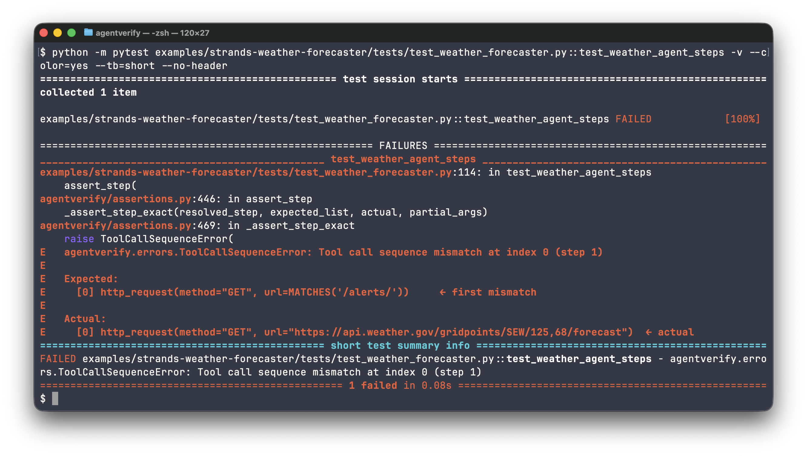

# agentverify

[](https://pypi.org/project/agentverify/)
[](https://pepy.tech/projects/agentverify)
[](https://github.com/simukappu/agentverify/actions/workflows/ci.yml)
[](https://coveralls.io/github/simukappu/agentverify?branch=main)
[](LICENSE)

**pytest for AI agents.** Assert agent actions, not vibes.

agentverify is a pytest plugin for deterministic testing of AI agent actions. Record real LLM calls once and replay them in CI with zero cost, or run against a live LLM with flexible matchers that tolerate prompt variation. Either way, assert exactly what your agent did: which tools it called, what data flowed between steps, how much it cost, and whether it stayed within your safety rules.



Specifically:

- **Tool call sequences**: exact order, subsequence, or set membership, with regex / wildcard argument matching
- **Step-level execution**: each LLM call is a step; assert what tool was called at step N, what the step's output was, and that step N's input references data produced by step M
- **Tool outcomes**: whether each tool call actually returned a usable result (vs. errored, timed out, or came back empty), what the result contained, and how many times a flaky tool was retried
- **Multi-agent routing**: which agent handed off to which, and which agent acted at each step
- **Budgets**: token counts, cost in USD, end-to-end latency
- **Safety**: a list of tools that must never be called, no matter what the LLM decides

Built-in adapters cover LangChain, LangGraph, Strands Agents, and OpenAI Agents SDK, and agents may be sync or async. A small [custom converter](#custom-converters) plugs in anything else, including pure-Python ReAct loops, the Anthropic / OpenAI SDK directly, and frameworks not listed above. LLM providers supported: OpenAI (Chat Completions and Responses), Amazon Bedrock, Google Gemini, Anthropic, and LiteLLM. Cassettes are human-readable YAML. Commit them to git, review in PRs, run in CI without an API key.

## Why I built this

When I started building agents that call tools in a loop, I ran into a failure mode that is easy to introduce and easy to miss: the agent calls the wrong tool, ignores a tool result, or quietly retries a failing call until the budget runs over. I wanted those caught in CI the way any other regression is. But the usual options did not fit. Mocking everything proves nothing, and running against a real LLM is unreliable, costs money, and needs an API key in CI.

What I wanted was boring. Run the agent once, record what it did, and assert on it in CI like any other function: the tool sequence, the arguments, the cost, the steps where one tool's output feeds the next. Review the recording in the PR next to the prompt change that produced it. No judge model, no scoring, no cloud account. agentverify is deliberately narrow, and the cassette-replay path is what keeps those tests in CI without a key or a bill.

This is probably for you if:

- You've shipped an agent that calls tools in a loop and need CI-safe regression tests for it
- You've hit bugs like "it ignored the tool result" or "it called the wrong tool"
- You want prompt and tool changes reviewed in PRs via a concrete diff, not an informal "looks fine locally" signoff
- You're building on MCP servers and need to pin down which tools get called with which arguments
- You want token, cost, and latency budgets enforced in CI, not caught only on the billing dashboard

This is the **regression-test layer** for agents: deterministic assertions on what the agent did. It's distinct from quality evaluation (LLM-as-judge scoring on open-ended output) and production trace observability, both of which are often used alongside agentverify rather than instead of it. See [Where agentverify fits](#where-agentverify-fits).

## Install

```bash
pip install agentverify
```

## Quick Start

After [installing](#install), copy this into `test_agent.py` and run `pytest`. No LLM calls, no API keys, no cassettes needed. Just pure assertions on an `ExecutionResult`.

```python
from agentverify import (
    ExecutionResult, ToolCall, ANY,
    assert_tool_calls, assert_cost, assert_no_tool_call, assert_final_output,
)

# Build an ExecutionResult from your agent's output (or a dict)
result = ExecutionResult.from_dict({
    "tool_calls": [
        {"name": "get_location", "arguments": {"city": "Tokyo"}},
        {"name": "get_weather", "arguments": {"lat": 35.6, "lon": 139.7}},
    ],
    "token_usage": {"input_tokens": 50, "output_tokens": 30},
    "total_cost_usd": 0.002,
    "final_output": "The weather in Tokyo is sunny, 22°C.",
})

def test_tool_sequence():
    assert_tool_calls(result, expected=[
        ToolCall("get_location", {"city": "Tokyo"}),
        ToolCall("get_weather", {"lat": ANY, "lon": ANY}),
    ])

def test_budget():
    assert_cost(result, max_tokens=500, max_cost_usd=0.01)

def test_safety():
    assert_no_tool_call(result, forbidden_tools=["delete_user", "drop_table"])

def test_output():
    assert_final_output(result, contains="Tokyo")
```

```
$ pytest test_agent.py -v
test_agent.py::test_tool_sequence PASSED
test_agent.py::test_budget PASSED
test_agent.py::test_safety PASSED
test_agent.py::test_output PASSED
```

> **Using a real agent framework?** Walk through the [Real-World Examples](#real-world-examples) below for in-depth walkthroughs with cassettes, or jump to the [Examples](#examples) table for a quick index of all runnable samples.

## Real-World Examples

End-to-end examples that showcase different agent patterns and testing angles. All run with pre-recorded cassettes, no API keys needed.

### Strands Weather Forecaster — Two-Step ReAct

Test the [Strands Weather Forecaster](https://strandsagents.com/docs/examples/python/weather_forecaster/), an official Strands Agents sample. The agent uses the `http_request` tool to call the National Weather Service API, which returns the forecast URL for the requested location; the agent then calls that URL to get the actual forecast. Two steps, one piece of data flowing between them: the simplest shape of a ReAct loop.

```python
import pytest
from agentverify import (
    assert_tool_calls, assert_cost, assert_latency,
    assert_no_tool_call, assert_final_output, assert_all,
    ToolCall, MATCHES,
)

# Import the weather agent from the Strands sample
# (see https://strandsagents.com/docs/examples/python/weather_forecaster/)
from weather_agent import weather_agent


@pytest.mark.agentverify
def test_weather_agent(cassette):
    """Verify tool sequence, budget, latency, safety, and final output in one go."""
    with cassette("weather_seattle.yaml", provider="bedrock") as rec:
        weather_agent("What's the weather in Seattle?")

    result = rec.to_execution_result()
    assert_all(
        result,
        # Two http_request calls with distinct URL shapes: location lookup then forecast
        lambda r: assert_tool_calls(r, expected=[
            ToolCall("http_request", {"method": "GET", "url": MATCHES(r"/points/")}),
            ToolCall("http_request", {"method": "GET", "url": MATCHES(r"/forecast")}),
        ]),
        lambda r: assert_cost(r, max_tokens=15000),
        lambda r: assert_latency(r, max_ms=10_000),
        lambda r: assert_no_tool_call(r, forbidden_tools=["write_file", "execute_command"]),
        lambda r: assert_final_output(r, contains="Seattle"),
    )
```

Want to go deeper? Step-level assertions verify the ReAct structure and the data flow between the two steps:

```python
from agentverify import assert_step, assert_step_uses_result_from

@pytest.mark.agentverify
def test_weather_agent_steps(cassette):
    with cassette("weather_seattle.yaml", provider="bedrock") as rec:
        weather_agent("What's the weather in Seattle?")
    result = rec.to_execution_result()

    # First step must call /points/ to discover the forecast office
    assert_step(result, step=0, expected_tool=ToolCall(
        "http_request", {"method": "GET", "url": MATCHES(r"/points/")},
    ), partial_args=True)

    # Second step must call /forecast/ AND use data from the first step's result
    assert_step(result, step=1, expected_tool=ToolCall(
        "http_request", {"method": "GET", "url": MATCHES(r"/forecast")},
    ), partial_args=True)
    assert_step_uses_result_from(result, step=1, depends_on=0)
```

`MATCHES(pattern)` is a regex matcher. See [Assertion Modes](#assertion-modes) for details on `ANY`, `MATCHES`, `OrderMode`, and `partial_args`. Step assertions are covered in [Step-Level Assertions](#step-level-assertions).

### OpenAI Agents SDK LLM as a Judge — Freezing a Probabilistic Refinement Loop

Test the [OpenAI Agents SDK `agent_patterns/llm_as_a_judge.py`](https://github.com/openai/openai-agents-python/blob/main/examples/agent_patterns/llm_as_a_judge.py) sample: a generator writes a story outline, an evaluator grades it with a structured `{feedback, score}` verdict, and the loop re-runs the generator with that feedback until the evaluator accepts the draft. Everything about this agent is probabilistic: how many rounds it takes, what the feedback says, whether the rewrite incorporates it. Recording one run freezes all of it into a deterministic test.

The headline assertion is the feedback chain: round 2's generator must actually consume round 1's evaluator feedback, not silently regenerate the same outline.

```python
import pytest
from agentverify import assert_step_uses_result_from, assert_step_output

# Import the judge loop from the example
# (see examples/openai-agents-llm-as-a-judge/)
from agent import run_judge_loop_sync


@pytest.mark.agentverify
def test_generator_consumes_evaluator_feedback(cassette):
    """Round 2's regeneration must reference the evaluator's round 1 feedback."""
    with cassette("detective_in_space.yaml", provider="openai") as rec:
        run_judge_loop_sync("A detective story in space.", max_rounds=3)
    result = rec.to_execution_result()

    # Step 1 is the evaluator's first verdict; it must reject on the first try.
    assert_step_output(
        result, step=1, matches=r'"score"\s*:\s*"(needs_improvement|fail)"'
    )
    # Step 2 (generator, round 2) must actually consume step 1's feedback.
    # This catches "agent regenerated but ignored the judge" bugs.
    assert_step_uses_result_from(result, step=2, depends_on=1)
```

`assert_step_uses_result_from` matches across JSON-serialization boundaries. The multi-line evaluator feedback is found inside the next step's user message even when newlines are escaped during serialization.

Because each `Runner.run` call is recorded individually and the workflow spans several runs, the test builds the `ExecutionResult` straight off the cassette recorder rather than the single-run `from_openai_agents` adapter. The cassette layer is the natural single source of truth when a test covers multiple agent runs.

See [`examples/openai-agents-llm-as-a-judge/`](examples/openai-agents-llm-as-a-judge/) for the full loop, the cassette, and the remaining flat + step-level assertions (budget, safety, pass-verdict reached).

### OpenAI Agents SDK on LiteLLM — An Async Agent

Test the [OpenAI Agents SDK `model_providers/litellm_provider.py`](https://github.com/openai/openai-agents-python/blob/main/examples/model_providers/litellm_provider.py) sample. `Runner.run` is async and `LitellmModel` calls `litellm.acompletion`, so the cassette is opened inside a coroutine:

```python
import asyncio
import pytest
from agentverify import ToolCall, assert_step_uses_result_from, assert_tool_calls

from agent import run_agent  # examples/openai-agents-litellm-provider/


@pytest.mark.agentverify
def test_answer_uses_the_weather_tool(cassette):
    async def main():
        with cassette("weather_tokyo.yaml", provider="litellm") as rec:
            await run_agent("What's the weather in Tokyo?")
        return rec.to_execution_result()

    result = asyncio.run(main())
    assert_tool_calls(result, expected=[ToolCall("get_weather", {"city": "Tokyo"})])
    # The answer step must read the tool's result, not guess the weather.
    assert_step_uses_result_from(result, step=1, depends_on=0, via="tool_result")
```

See [`examples/openai-agents-litellm-provider/`](examples/openai-agents-litellm-provider/) for the agent, the cassette, and the remaining assertions.

### LangGraph + LangChain — Multi-Agent Handoff and MCP Tool Loops

Full-depth examples for the LangChain ecosystem live under [`examples/`](examples/):

- **[LangGraph multi-agent supervisor](examples/langgraph-multi-agent-supervisor/)**: a supervisor routes to a research expert and a math expert; each `add` in the math chain must consume the previous `add`'s result. `assert_step_uses_result_from` matches the numeric running total (`"231317.0"` produced as a string, consumed as `231317` int/float) across type boundaries, with digit-boundary checks that keep `"231"` from falsely appearing inside `1231`.
- **[LangChain GitHub issue triage](examples/langchain-issue-triage/)**: a `create_react_agent` drives the GitHub MCP server to list issues, read one, propose labels. The step-level tests verify that the `issue_number` passed to `get_issue` actually came from the preceding `list_issues` response, that the GitHub reads returned usable results (`assert_no_tool_errors`, `assert_tool_result_matches`), and that destructive tools like `close_issue` are never called.

Each example ships with its own pre-recorded cassette, a detailed `README.md`, and a full test file. Pick whichever framework fits your stack.

## Build an ExecutionResult

Every agentverify assertion takes an `ExecutionResult`. You can build one three ways:

1. **From a dict**: convenient for quick tests and fixtures, as in the [Quick Start](#quick-start).
2. **From a built-in adapter**: one-liner for LangChain, LangGraph, Strands Agents, OpenAI Agents SDK. See [Framework Integration](#framework-integration).
3. **From a custom converter**: for frameworks or pure-Python agents not covered by a built-in adapter, map your output to the schema below. See [`examples/custom-converter-python-agent/`](examples/custom-converter-python-agent/) for a complete walkthrough with an Anthropic SDK agent, including a pre-recorded cassette and step-level tests.

`ExecutionResult.from_dict()` accepts these keys:

| Key | Type | Description |
|---|---|---|
| `steps` | `list[dict]` | Each step dict has `index` (int), `source` (`"llm"` / `"probe"` / `"tool"`), `tool_calls` (list), `tool_results` (list), `output` (str or None), `input_context` (dict or None), `name` (str or None). See [Step-Level Assertions](#step-level-assertions) |
| `tool_calls` | `list[dict]` | **Shortcut for single-step cases**: when `steps` is absent, a flat `tool_calls` list is wrapped into a single synthetic step. Used throughout the [Quick Start](#quick-start). Each dict has `name` (str, required), `arguments` (dict, optional), `result` (any, optional) |
| `token_usage` | `dict` or `None` | `{"input_tokens": int, "output_tokens": int}` |
| `total_cost_usd` | `float` or `None` | Total cost in USD (must be set manually, not auto-calculated from tokens or populated from cassettes) |
| `duration_ms` | `float` or `None` | Wall-clock duration in milliseconds (auto-populated by the `cassette` fixture and `MockLLM`) |
| `final_output` | `str` or `None` | The agent's final text response |

`ExecutionResult.from_json(json_string)` and `to_dict()` / `to_json()` are also available for serialization.

## Record & Replay with Cassettes

Record real LLM API calls once, then replay them in CI forever. Zero cost, fully deterministic.

```python
import pytest
from agentverify import assert_tool_calls, ToolCall, ANY

@pytest.mark.agentverify
def test_weather_agent(cassette):
    with cassette("weather_agent.yaml", provider="openai") as rec:
        # Replace this with your actual agent invocation, e.g.:
        # agent.run("What's the weather in Tokyo?")
        run_my_agent("What's the weather in Tokyo?")

    # rec.to_execution_result() is called AFTER the with block exits
    result = rec.to_execution_result()
    assert_tool_calls(result, expected=[
        ToolCall("get_location", {"city": "Tokyo"}),
        ToolCall("get_weather", {"lat": ANY, "lon": ANY}),
    ])
```

The `cassette` fixture is provided by the agentverify pytest plugin. It creates an `LLMCassetteRecorder` that intercepts LLM SDK calls (not HTTP; it patches the SDK's chat completion method directly). Use `@pytest.mark.agentverify` to mark your test, and call your agent code inside the `with cassette(...)` block. After the block exits, call `rec.to_execution_result()` to build the result for assertions.

Record the cassette once, then replay it forever:

```bash
# First run: record real LLM calls to cassette file
pytest --cassette-mode=record

# All subsequent runs: replay from cassette (zero cost, deterministic)
pytest
```

Cassettes are human-readable YAML (or JSON). Commit them to git, review in PRs.

agentverify supports three cassette modes:

| Mode | Behavior |
|---|---|
| `AUTO` (default) | If cassette file exists → REPLAY. Otherwise → call real LLM API but don't save (no cassette file is created). |
| `RECORD` | Always call real LLM API and save to cassette file. |
| `REPLAY` | Always replay from cassette file. Raises error if file is missing. |

### Stale Cassette Detection

Cassette replay verifies request content by default so a stale cassette fails loudly instead of returning the old response. Each replay request is compared against the recorded request:
- **Model name**: must match exactly (empty model in either side skips the check)
- **Tool names**: the sorted list of tool names must match (empty tools in either side skips the check)

A `CassetteRequestMismatchError` is raised on mismatch with a clear message indicating which field differs and suggesting re-recording.

To disable matching (e.g., during migration):

```bash
# CLI: disable for all tests
pytest --no-cassette-match-requests
```

```python
# Per-test: disable in the cassette factory call
with cassette("my_test.yaml", provider="openai", match_requests=False) as rec:
    run_my_agent("What's the weather?")
```

### Keeping Cassettes Current

Cassettes drift when your prompts, tool schemas, or model versions change. agentverify's stale detection catches model-name and tool-name mismatches automatically (see [Stale Cassette Detection](#stale-cassette-detection)); a prompt-only change won't invalidate the cassette unless the model's tool-call output differs. In practice:

- Re-record on major prompt rewrites or tool schema changes
- Pin model versions (`gpt-4o-2024-08-06`, not `gpt-4o`) in your agent code so cassettes don't silently shift underneath you
- Treat cassette diffs as part of the PR review. A YAML diff next to the prompt diff is a feature, not noise
- Use `MATCHES` and `partial_args=True` to assert on the stable parts of tool arguments, so small wording changes in LLM outputs don't cascade into test failures

### Calls Cassettes Cannot Record

Cassettes record non-streaming chat calls, sync or async: OpenAI `chat.completions.create` and `responses.create`, Anthropic `messages.create`, Gemini `models.generate_content`, Bedrock `Converse`, and LiteLLM `completion` / `acompletion`. Inside a cassette or `MockLLM`, agentverify raises `CassetteUnsupportedCallError` instead of letting other LLM calls reach the real API:
- Streaming entry points (`stream=True`, `messages.stream()`, `generate_content_stream()`, Bedrock `ConverseStream`, OpenAI Responses `stream()`), in record and replay mode.
- In replay mode, every other request through an OpenAI, Anthropic, or Gemini SDK client, including `parse()` and embeddings. Bedrock operations that generate (`InvokeModel`, `InvokeAgent`, `RetrieveAndGenerate`, ...) and LiteLLM `text_completion` and `responses` raise too.
- LLM calls that overlap in time while recording (`asyncio.gather`, threads). They finish in a different order on each run, so the cassette would replay the wrong response. Await them one at a time.
- In record mode, the entry points named above run with a warning. Other requests (beta resources, WebSocket APIs) run without one, and replay then fails at that call.
- With no cassette file (`AUTO` passthrough), nothing is saved and no guard applies.

Frameworks that stream by default need streaming turned off, e.g. `BedrockModel(streaming=False)` in Strands.

### OpenAI Responses API

`responses.create` is recorded in the same `provider="openai"` cassette as Chat Completions, including the `with_raw_response` path that langchain-openai uses. The OpenAI Agents SDK uses it by default, so `set_default_openai_api("chat_completions")` is no longer needed. Tool results sent back as `function_call_output` items become the step's `tool_results`, so `assert_step_uses_result_from` works the same way. Only function tools are recorded: a response with a client-executed computer, shell, apply-patch, or custom tool call raises `CassetteUnsupportedCallError`.

With `previous_response_id` or `conversation`, the API keeps earlier turns on the server and each request carries only the new input. The cassette then misses those turns, and agentverify warns. Pass `store=False` and send the full input instead.

### Async Agents

The cassette is a plain context manager, so it works around `await` calls too, either in a sync test that runs the agent with `asyncio.run()` or inside your own async test (agentverify does not depend on `pytest-asyncio` or `anyio`; use whichever you already have):

```python
def test_async_agent(cassette):
    async def main():
        with cassette("judge.yaml", provider="openai") as rec:
            await run_agent("A detective story in space.")
        return rec.to_execution_result()

    result = asyncio.run(main())
    assert_final_output(result, contains="detective")
```

Async clients of OpenAI, Anthropic, Gemini, and LiteLLM are recorded and replayed. Async Bedrock (`aiobotocore`) is neither recorded nor guarded yet, so its calls reach AWS even in replay mode.

### Cassette Sanitization

Cassettes are sanitized by default when recording. Before saving, agentverify redacts:
- values that match a built-in key pattern, anywhere in the cassette
- call arguments and headers under a credential key, whatever their format: `api_key`, `authorization`, `x-api-key`, `cookie`, and names ending in `token`, `secret`, `password`, and similar (for example in `extra_headers`)

Built-in patterns (`DEFAULT_PATTERNS`) cover:
- OpenAI and Anthropic API keys (`sk-...`, `sk-ant-...`)
- AWS access keys (`AKIA...`, `ASIA...`)
- Amazon Bedrock API keys (`ABSK...`, `bedrock-api-key-...`)
- Google API keys (`AIza...`)
- GitHub tokens (`ghp_...`, `github_pat_...`)
- Bearer tokens (`Bearer ...`)

A custom list replaces the built-in patterns, so extend `DEFAULT_PATTERNS` to keep them. Credential keys in call arguments are redacted either way:

```python
from agentverify import DEFAULT_PATTERNS, SanitizePattern

custom_patterns = [
    *DEFAULT_PATTERNS,
    SanitizePattern(name="internal_token", pattern=r"tok-[a-f0-9]{32}", replacement="tok-***REDACTED***"),
]

with cassette("test.yaml", provider="openai", sanitize=custom_patterns) as rec:
    run_my_agent("Do something")
```

Pass `sanitize=False` to disable sanitization entirely (not recommended).

## Assertion Modes

```python
from agentverify import assert_tool_calls, OrderMode, ToolCall, ANY, MATCHES

# Exact match: same tools, same order, same count (default)
assert_tool_calls(result, expected=[...])

# Subsequence: these tools appeared in this order (other calls in between are OK)
assert_tool_calls(result, expected=[...], order=OrderMode.IN_ORDER)

# Set membership: these tools were called (order doesn't matter)
assert_tool_calls(result, expected=[...], order=OrderMode.ANY_ORDER)

# Partial args: only check the keys you care about
assert_tool_calls(result, expected=[
    ToolCall("search", {"query": "Tokyo"}),
], partial_args=True)

# ANY wildcard: ignore a specific argument value
assert_tool_calls(result, expected=[
    ToolCall("get_weather", {"lat": ANY, "lon": ANY}),
])

# MATCHES regex: verify a string argument follows a pattern
# (re.search semantics; use ^/$ anchors for full match)
assert_tool_calls(result, expected=[
    ToolCall("send_email", {"to": MATCHES(r"^[\w.+-]+@example\.com$")}),
    ToolCall("log_event", {"event_id": MATCHES(r"^evt_[a-f0-9]{16}$")}),
])
```

Collect all failures at once instead of stopping at the first:

```python
from agentverify import assert_all
assert_all(
    result,
    lambda r: assert_tool_calls(r, expected=[...]),
    lambda r: assert_cost(r, max_tokens=1000),
    lambda r: assert_latency(r, max_ms=3000),
    lambda r: assert_no_tool_call(r, forbidden_tools=["delete_user"]),
    lambda r: assert_final_output(r, contains="Tokyo"),
)
```

### Cost Assertions

`assert_cost()` enforces token and dollar budgets on an agent run. Either bound is optional. Pass `max_tokens` only, `max_cost_usd` only, or both together:

```python
from agentverify import assert_cost

# Token budget only
assert_cost(result, max_tokens=500)

# Dollar budget only
assert_cost(result, max_cost_usd=0.01)

# Both: fail if either is exceeded
assert_cost(result, max_tokens=500, max_cost_usd=0.01)
```

`result.token_usage` is populated automatically by the `cassette` fixture, `MockLLM`, and every built-in framework adapter. `result.total_cost_usd` must be set manually (see [Build an ExecutionResult](#build-an-executionresult)). agentverify does not compute dollar costs from tokens, since the pricing table would need per-model maintenance and get stale quickly.

### Latency Assertions

`assert_latency()` enforces a response time SLA on your agent. When you use the `cassette` fixture, wall-clock duration is captured automatically on context exit and exposed as `ExecutionResult.duration_ms`:

```python
from agentverify import assert_latency

@pytest.mark.agentverify
def test_weather_agent_latency(cassette):
    with cassette("weather_seattle.yaml", provider="bedrock") as rec:
        weather_agent("What's the weather in Seattle?")

    result = rec.to_execution_result()
    # Fail if the whole agent run took more than 3 seconds
    assert_latency(result, max_ms=3000)
```

During cassette **replay**, the measured duration reflects replay time (typically milliseconds), not the original call time. Capture latency data during **record** mode, or set `duration_ms` manually via [`ExecutionResult.from_dict()`](#build-an-executionresult).

### Final Output Assertions

`assert_final_output()` verifies the agent's final text response. Use `contains` for substring checks, `equals` for exact match, or `matches` for regex:

```python
from agentverify import assert_final_output

# Substring check
assert_final_output(result, contains="Tokyo")

# Exact match
assert_final_output(result, equals="The weather in Tokyo is sunny, 22°C.")

# Regex match
assert_final_output(result, matches=r"\d+°C")
```

`contains` also accepts a list; every substring must appear. `case_sensitive=False` ignores case in `contains` only; for a case-insensitive regex, put `(?i)` in the pattern. `assert_step_output` and `assert_tool_result_matches` accept the same options:

```python
assert_final_output(result, contains=["Tokyo", "22°C"])
assert_final_output(result, contains="tokyo", case_sensitive=False)
```

### Strict Mode

`assert_cost()` and `assert_latency()` silently pass when the underlying data (`token_usage`, `total_cost_usd`, `duration_ms`) is `None`. Useful during cassette replay where some data may be unavailable. Pass `strict=True` to require the data to be present:

```python
# Fails if token_usage or total_cost_usd is None
assert_cost(result, max_tokens=500, max_cost_usd=0.01, strict=True)

# Fails if duration_ms is None
assert_latency(result, max_ms=3000, strict=True)
```

## Step-Level Assertions

For agents that make multiple LLM calls per execution (ReAct, Plan-and-Execute, multi-hop retrieval, workflow-style), agentverify exposes the full step structure, not just a flat list of tool calls.

`ExecutionResult.steps` is the single source of truth; `result.tool_calls` remains as a derived flat view for simpler cases.

> The [Real-World Examples](#real-world-examples) above show `assert_step` and `assert_step_uses_result_from` in action on Strands and the OpenAI Agents SDK; the LangGraph, LangChain, and pure-Python custom-converter examples linked from there exercise the same API on different agent shapes. This section covers the full API.

```python
from agentverify import assert_step, assert_step_output, ToolCall, MATCHES

@pytest.mark.agentverify
def test_plan_and_execute(cassette):
    with cassette("trip_planner.yaml", provider="openai") as rec:
        plan_trip("2 nights in Shibuya, Tokyo")
    result = rec.to_execution_result()

    # Step 0: agent plans what to search for
    assert_step_output(result, step=0, contains="flights")

    # Step 1: agent calls the flight search tool
    assert_step(result, step=1, expected_tool=ToolCall("search_flights", {"city": "Tokyo"}))

    # Step 2: agent calls the hotel search with the neighborhood the user asked for
    assert_step(result, step=2, expected_tool=ToolCall("search_hotels", {"area": MATCHES(r"Shibuya")}))
```

### Assert Step-to-Step Data Flow

`assert_step_uses_result_from()` verifies that one step's input references data produced by another. Catches "agent ignored the tool result" bugs.

```python
from agentverify import assert_step_uses_result_from

# Verify step 2 (hotel search) actually uses the result of step 1 (flight search)
assert_step_uses_result_from(result, step=2, depends_on=1)

# Restrict to a specific channel
assert_step_uses_result_from(result, step=2, depends_on=1, via="tool_result")
```

The check searches for any produced value (step M's `tool_results`, `tool_calls[*].result`, or `output`) inside step N's `input_context` or `tool_calls[*].arguments`. Strings are substring-matched; primitives (numbers, booleans) are matched structurally inside containers; JSON-encoded tool results are descended automatically.

To see this concretely with a different example: if step 0's `list_issues` tool returned `[{"number": 1}, {"number": 2}]` and step 1 called `get_issue(issue_number=2)`, the check finds that the number `2` produced by step 0 shows up in step 1's arguments. Data flows correctly. This is exactly the pattern the [LangChain GitHub issue triage example](examples/langchain-issue-triage/) verifies.

This works on cassette replay. Cassette recorders don't record tool execution results directly, but agentverify backfills them from the next step's `input_context` so you can assert data flow without any special adapter setup.

### Workflow-Style Agents with `step_probe`

Many production agents aren't pure ReAct loops. They mix LLM calls with caching, state management, validation, and conditional branches. `step_probe()` lets you mark logical step boundaries in your agent code so tests can assert on those non-LLM steps.

```python
# agent.py
from agentverify import step_probe

def run_agent(query: str) -> str:
    with step_probe("fetch_cache") as p:
        cached = cache.get(query)
        p.set_tool_result({"hit": cached is not None})
        if cached:
            return cached
    with step_probe("call_llm"):
        response = llm.invoke(query)
    with step_probe("postprocess", output="formatted"):
        return format_output(response)
```

```python
# test_agent.py
def test_cache_miss_path():
    with MockLLM([mock_response(content="42")], provider="openai") as rec:
        run_agent("what's the answer?")
    result = rec.to_execution_result()
    assert_step(result, name="fetch_cache", expected_tools=[])  # probe with no tool calls
    assert_step_output(result, name="call_llm", contains="42")  # the LLM step returned the answer
    assert_step_output(result, name="postprocess", equals="formatted")
```

**`step_probe` is a zero-cost no-op outside of test recording contexts.** When no `LLMCassetteRecorder` or `MockLLM` is active, it's a pass-through context manager. Safe to leave in production code.

## Multi-Agent Handoffs

In a multi-agent run, assert which agent handed control to which, and which agent acted at a step.

```python
from agentverify import ANY, Handoff, ToolCall, assert_handoffs, assert_no_handoff, assert_step

assert_handoffs(result, expected=[
    Handoff("supervisor", "research_expert"),
    Handoff("research_expert", "supervisor"),
    Handoff("supervisor", "math_expert"),
])  # order=OrderMode.EXACT (default), IN_ORDER, or ANY_ORDER

assert_no_handoff(result, to_agent="admin_expert")

assert_step(result, step=1, agent="research_expert", expected_tool=ToolCall("web_search", ANY))
```

`result.handoffs` lists them, and `Step.agent` names the agent at each step.

- `from_openai_agents` and `from_langgraph` take agent names from the framework, and a handoff is a change of acting agent. Tool names are not read, so an ordinary tool named `transfer_to_savings` is not a handoff and a handoff tool renamed with `tool_name_override` still is.
- A cassette has no agent names. It reads handoffs from the `transfer_to_<agent>` / `transfer_back_to_<agent>` tool calls that the OpenAI Agents SDK and langgraph-supervisor make, and names each step after the last handoff in its request history. The first agent is unnamed (`Handoff(ANY, "research_expert")`), and returns to a supervisor are seen only when the framework writes them into the history, as langgraph-supervisor does by default.

Plain-string names compare as handoff tools spell them: `"Billing Agent"` matches `billing_agent`.

## Tool Result Assertions

Knowing the agent *called* the right tool is not the same as knowing the call *worked*. A tool can return a 5xx, time out, or hand back an empty body, and the LLM will often smooth that over in its final reply. These assertions check the result a tool handed back, not just which tool was called and with what arguments.

```python
from agentverify import (
    assert_tool_invocation_succeeded,
    assert_no_tool_errors,
    assert_tool_result_matches,
    assert_retry_count,
)

# Affirmative: the tool call(s) at this step returned a usable result
assert_tool_invocation_succeeded(result, step=1)

# Blanket safety net: no tool anywhere in the run errored
assert_no_tool_errors(result)

# The tool returned a well-shaped / non-empty result
assert_tool_result_matches(result, step=1, contains="temperature")
assert_tool_result_matches(result, step=1, matches=r'"temp":\s*\d+')
# Every substring must appear in the same tool result; case_sensitive=False ignores case
assert_tool_result_matches(result, step=1, contains=["temp", "unit"], case_sensitive=False)

# Budget on retries of a flaky tool (counted from consecutive repeat calls)
assert_retry_count(result, tool_name="http_request", max=2)
```

agentverify reads a per-result error signal that the built-in adapters populate from each framework's native tool-error convention (LangGraph `ToolMessage.status == "error"`, Strands `toolResult` status, OpenAI Agents SDK default failure and timeout messages, LangChain error-shaped observations), and that cassette replay reconstructs from the recorded tool messages.

The signal is three-valued: a result is a **known error**, a **known success**, or **unknown** (for example, a plain-string tool output on cassette replay where no structured status survived). `assert_tool_invocation_succeeded` and `assert_no_tool_errors` fail only on a *known* error; unknown and absent results pass, so the same test gives the same verdict whether it runs against a live agent or a replayed cassette. To require that a result is actually present and well-formed, use `assert_tool_result_matches`, which fails when the step has no tool result at all.

`assert_no_tool_errors` is a blanket gate, so reach for it only when every tool in the run is expected to succeed. If your agent's correct behaviour includes recovering from a failure (a 429 then a retry, a primary tool then a fallback), that trajectory contains an expected error, and the blanket gate would flag it. In that case assert success on the specific steps that must succeed with `assert_tool_invocation_succeeded(step=N)` instead.

If you build an `ExecutionResult` by hand or with a custom converter, set the signal yourself via the `tool_results_meta` field on each `Step`: a list positionally aligned with `tool_results`, where entry `i` is `{"is_error": True}`, `{"is_error": False}`, or `{}` (unknown). With `step_probe`, pass it through `handle.set_tool_result(result, is_error=True)`.

## Framework Integration

### Built-in Adapters

agentverify ships with built-in adapters for popular agent frameworks. No converter function needed. Just import and call:

| Framework | Adapter | Input |
|---|---|---|
| [LangChain](https://github.com/langchain-ai/langchain) | `from agentverify.frameworks.langchain import from_langchain` | `AgentExecutor.invoke()` dict |
| [LangGraph](https://github.com/langchain-ai/langgraph) | `from agentverify.frameworks.langgraph import from_langgraph` | `create_react_agent` result dict |
| [Strands Agents](https://github.com/strands-agents/sdk-python) | `from agentverify.frameworks.strands import from_strands` | `AgentResult` |
| [OpenAI Agents SDK](https://github.com/openai/openai-agents-python) | `from agentverify.frameworks.openai_agents import from_openai_agents` | `RunResult` |

For LangChain, pass the conversation history `messages` list as a second argument to capture token usage:

```python
from agentverify.frameworks.langchain import from_langchain

execution_result = from_langchain(result, messages=memory.chat_memory.messages)
```

LangGraph, Strands, and OpenAI Agents adapters take the raw agent output directly:

```python
from agentverify.frameworks.langgraph import from_langgraph
from agentverify.frameworks.strands import from_strands
from agentverify.frameworks.openai_agents import from_openai_agents

# LangGraph: create_react_agent / create_supervisor result
execution_result = from_langgraph(app.invoke({"messages": [...]}))

# Strands: agent call result
execution_result = from_strands(weather_agent("What's the weather in Seattle?"))

# OpenAI Agents SDK: Runner.run_sync() / await Runner.run() result
execution_result = from_openai_agents(Runner.run_sync(agent, "your prompt"))
```

### Custom Converters

For other frameworks, build an `ExecutionResult` from your agent's output using a small converter function. See [`examples/custom-converter-python-agent/`](examples/custom-converter-python-agent/) for a complete reference: an Anthropic SDK ReAct agent paired with a ~80-line `converter.py`, a recorded cassette, and step-level tests.

## Supported LLM Providers

| Provider | Extra |
|---|---|
| OpenAI | `pip install "agentverify[openai]"` |
| Amazon Bedrock | `pip install "agentverify[bedrock]"` |
| Google Gemini | `pip install "agentverify[gemini]"` |
| Anthropic | `pip install "agentverify[anthropic]"` |
| LiteLLM | `pip install "agentverify[litellm]"` |
| All providers | `pip install "agentverify[all]"` |

OpenAI models on Amazon Bedrock can be reached three ways; record each with the provider that owns the client:

| Route | Cassette provider |
|---|---|
| boto3 `bedrock-runtime` `converse` | `"bedrock"` |
| OpenAI SDK with `base_url="https://bedrock-runtime.<region>.amazonaws.com/openai/v1"` (`chat.completions.create`, `responses.create`) | `"openai"` |
| boto3 `invoke_model` | not recorded; raises in replay mode |

## LLM Mocking with MockLLM

`MockLLM` replays a list of predefined LLM responses that you define in code. Test your agent's routing logic without a cassette or a real LLM call. Useful when you haven't recorded yet, or when you want to drive the agent through hypothetical responses (errors, edge cases) that would be awkward to elicit from a real model.

```python
import pytest
from agentverify import (
    MockLLM, mock_response, ToolCall,
    assert_tool_calls, assert_no_tool_call,
)

def test_agent_routes_to_weather_tool():
    with MockLLM([
        mock_response(tool_calls=[("get_weather", {"city": "Tokyo"})]),
        mock_response(content="Tokyo is sunny, 22°C."),
    ], provider="openai") as rec:
        my_agent("What's the weather in Tokyo?")

    result = rec.to_execution_result()
    assert_tool_calls(result, expected=[ToolCall("get_weather", {"city": "Tokyo"})])
    assert_no_tool_call(result, forbidden_tools=["delete_user"])
```

`mock_response()` accepts:

- `content`: the final text message the LLM should return.
- `tool_calls`: a list of `(name, arguments)` tuples or `{"name": ..., "arguments": ...}` dicts.
- `input_tokens` / `output_tokens`: optional token usage to report.

Provide one `mock_response(...)` per LLM call your agent is expected to make. If your agent makes more calls than you've queued, `MockLLM` raises [`CassetteMissingRequestError`](#error-messages) so under-specified tests fail loudly.

### When to Use MockLLM vs Cassettes

| Use MockLLM when | Use cassettes when |
|---|---|
| You haven't recorded a cassette yet | You want fidelity with real LLM output |
| You want to test hypothetical scenarios (errors, edge cases) | You want to catch prompt-regression bugs |
| You're doing behavior-driven tests of routing | You're regression-testing full agent runs |
| You want zero dependency on any API key | You've already got recordings to replay |

## CI Integration

agentverify is designed for CI pipelines. Commit your cassette files to git and replay them in CI with zero LLM cost.

### GitHub Actions

```yaml
name: Agent Tests
on: [push, pull_request]

jobs:
  test:
    runs-on: ubuntu-latest
    steps:
      - uses: actions/checkout@v5
      - uses: actions/setup-python@v6
        with:
          python-version: "3.14"
      # Shown separately here for clarity. In practice, list agentverify
      # alongside the rest of your project's deps in requirements.txt.
      - run: pip install "agentverify[all]"
      - run: pip install -r requirements.txt  # your project's deps
      - run: pytest --tb=short -v
```

Cassette files in `tests/cassettes/` are replayed automatically. No API keys or secrets needed in CI.

## Error Messages

Clear, structured output when assertions fail:

```
ToolCallSequenceError: Tool call sequence mismatch at index 1 (step 0)

Expected:
  [0] get_location(city="Tokyo")
  [1] get_news(topic="weather")     ← first mismatch

Actual:
  [0] get_location(city="Tokyo")
  [1] search_web(query="Tokyo weather")  ← actual
```

```
CostBudgetError: Token budget exceeded

  Actual:  1,100 tokens
  Limit:   1,000 tokens
  Exceeded by: 100 tokens (10.0%)
```

```
LatencyBudgetError: Latency budget exceeded

  Actual:  3,450.0 ms
  Limit:   3,000.0 ms
  Exceeded by: 450.0 ms (15.0%)
```

Other error types follow the same pattern: `SafetyRuleViolationError`, `FinalOutputError`, `CassetteRequestMismatchError` (stale cassette detected), `CassetteMissingRequestError` (cassette or MockLLM ran out of queued responses), and the step-level `StepIndexError`, `StepNameNotFoundError`, `StepNameAmbiguousError`, `StepOutputError`, `StepDependencyError`. All inherit from `AgentVerifyError`, which itself extends `AssertionError` so pytest treats them as normal test failures.

## Requirements

- Python 3.10+
- pytest 7+

## Examples

The [`examples/`](examples/) directory contains end-to-end examples with real agent frameworks and MCP servers. Each example ships with pre-recorded cassettes, so tests run without any API keys.

| Example | Framework | Description |
|---|---|---|
| [`langchain-issue-triage`](examples/langchain-issue-triage/) | LangChain + OpenAI | Triages GitHub issues via GitHub MCP, step-level data flow for the discovered issue number, tool-result outcome checks |
| [`langgraph-multi-agent-supervisor`](examples/langgraph-multi-agent-supervisor/) | LangGraph + OpenAI | Research + math multi-agent handoff with running-total data flow |
| [`strands-weather-forecaster`](examples/strands-weather-forecaster/) | Strands Agents + Bedrock | Two-step ReAct that discovers a forecast URL, then calls it |
| [`openai-agents-llm-as-a-judge`](examples/openai-agents-llm-as-a-judge/) | OpenAI Agents SDK | Probabilistic generator ↔ evaluator refinement loop, frozen into a deterministic test with feedback-chain data flow |
| [`openai-agents-litellm-provider`](examples/openai-agents-litellm-provider/) | OpenAI Agents SDK + LiteLLM + Bedrock | Async agent (`Runner.run` → `litellm.acompletion`) with a weather tool, cassette opened inside a coroutine |
| [`custom-converter-python-agent`](examples/custom-converter-python-agent/) | Anthropic SDK (no framework) | Reference for writing a custom converter: a hand-rolled ReAct loop calling the Anthropic Messages API directly |
| [`mcp-server`](examples/mcp-server/) | (shared utility) | Mock GitHub MCP server for token-free testing |

See each example's README for setup and recording mode details.

## Benchmark

The [`benchmarks/execution-model-trajectory/`](benchmarks/execution-model-trajectory/) directory contains a comparison study that writes the same execution-trajectory assertion in three different assertion-execution-model styles (inline pytest via agentverify, separate-runner via [DeepEval](https://www.deepeval.com/docs/evaluation-llm-tracing) [`ToolCorrectnessMetric`](https://www.deepeval.com/docs/metrics-tool-correctness) + `@observe`, managed remote via [Amazon Bedrock AgentCore Evaluations Custom code-based evaluator](https://docs.aws.amazon.com/bedrock-agentcore/latest/devguide/code-based-evaluators.html) on Lambda) over two agents (Strands single-agent ReAct and LangGraph multi-agent supervisor). Per-cell numbers (LOC, wall time, API calls, dollar cost, CI secrets, cold-start) are recorded under [`results/`](benchmarks/execution-model-trajectory/results/). See the bench's [`README.md`](benchmarks/execution-model-trajectory/README.md) for the operating manual and [`DESIGN.md`](benchmarks/execution-model-trajectory/DESIGN.md) for the methodology and explicit non-goals. The benchmark is a one-time exercise that refreshes when tooling versions change materially, not a continuous CI gate.

## Where agentverify fits

agentverify does one job in agent evaluation: deterministic regression tests on what the agent did. It runs next to a quality-evaluation tool, not instead of one:

- **On every PR: agentverify.** Assert tool calls, arguments, step-to-step data flow, handoffs, cost, and latency in pytest. Replay needs no LLM call, no secret, and no cloud account, and runs in seconds.
- **On staging, on a schedule: a judge-based evaluator** such as Amazon Bedrock AgentCore Evaluations, DeepEval, or LangSmith. Score answer quality, run datasets, and reuse production traces, where the judge model's cost is worth paying.

## Roadmap

We want agentverify to become the way people regression-test agents in CI: tests that live next to the agent code, in git, reviewed in PRs alongside the prompt and tool changes that affect them.

- Concurrent LLM calls: record and replay calls that overlap (`asyncio.gather`), and async Bedrock (`aiobotocore`)
- Streaming: record and replay streamed responses, which raise `CassetteUnsupportedCallError` today
- Framework adapters for Google ADK and CrewAI

## Changelog

See [CHANGELOG.md](CHANGELOG.md) for release history.

## License

[MIT](LICENSE)

## Contributing

Contributions welcome. Please open an issue first to discuss what you'd like to change. See [CONTRIBUTING.md](CONTRIBUTING.md) for commit, CHANGELOG, and coverage conventions.

Development setup:

```bash
git clone https://github.com/simukappu/agentverify.git
cd agentverify
python -m venv .venv && source .venv/bin/activate
pip install -e ".[dev]"
pytest
```
